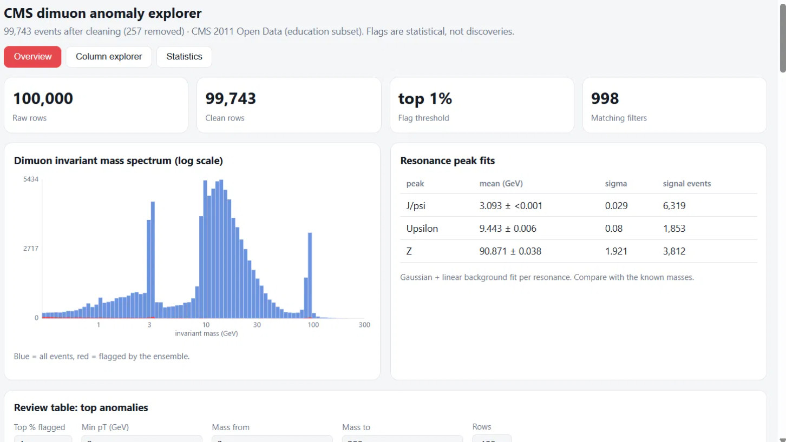
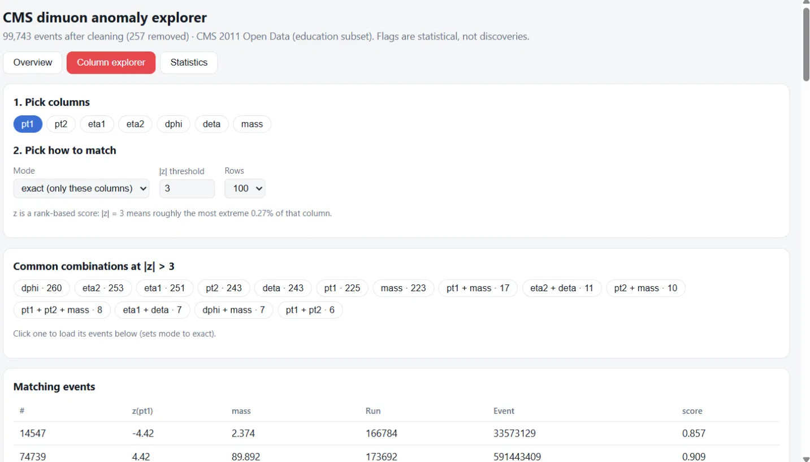
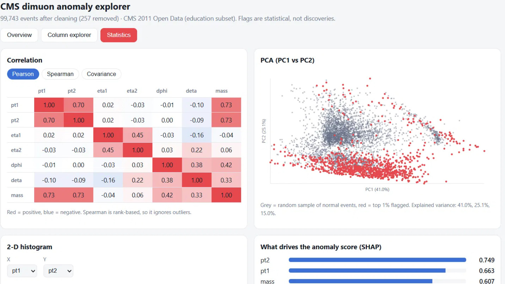
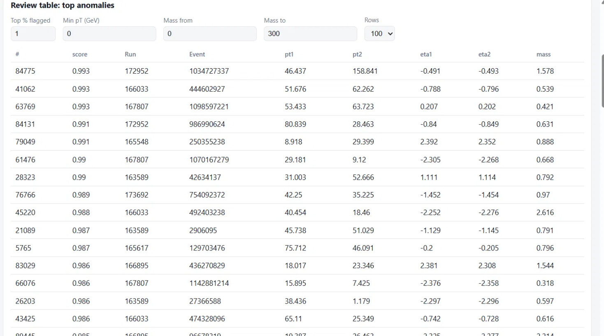
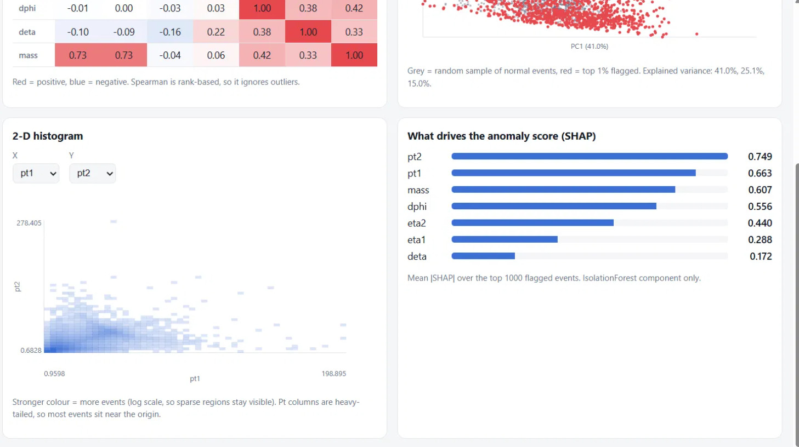

# CMS Dimuon Anomaly Explorer

An interactive tool for exploring 100,000 muon-pair collision events from the CMS experiment (2011 open data). It cleans the data with basic physics checks, flags statistically unusual events with an ensemble of outlier detectors, and shows *why* each event was flagged.



| Column explorer | Statistics |
|---|---|
|  |  |

> **Status: learning and exploration project.** Flags are statistical outliers, **not** physics discoveries. See [Limitations](#limitations).

## Highlights

- Physics-based data cleaning: invariant mass is recomputed from E and momentum and checked against the supplied value (100,000 events in, 99,743 out).
- Sanity check against known physics: fitted J/psi, Upsilon and Z peaks land close to their known masses.
- Rank-averaged ensemble of three outlier detectors (Isolation Forest, Local Outlier Factor, Mahalanobis distance).
- Explainability: per-column z-scores and SHAP attributions for each flagged event.
- Full stack: FastAPI backend with a documented API, React + Vite dashboard.

## Background in 60 seconds

In a dimuon event the detector records two muons. Combining their energies and momenta gives the **invariant mass** of whatever produced them. Heavy particles that decay into two muons show up as **peaks** in the mass spectrum at their own mass:

| Resonance | Known mass (GeV) |
|---|---|
| J/psi | 3.097 |
| Upsilon | 9.460 |
| Z boson | 91.19 |

These peaks are a free sanity check: if the cleaning and fitting are right, the peaks must land in the right place.

## Key results

**Cleaning:** 100,000 events in, **99,743** out (1 negative M-squared, 9 recomputed-mass mismatches, 247 inconsistent pT).

**Peak fits** (Gaussian plus linear background):

| Resonance | Fitted mean (GeV) | Known (GeV) |
|---|---|---|
| J/psi | 3.093 | 3.097 |
| Upsilon | 9.443 | 9.460 |
| Z | 90.87 | 91.19 |

**What the top 1% most anomalous events look like (998 events):**

| Property | Flagged | All other events |
|---|---|---|
| Nearly collinear muons (deta < 0.05 and dphi < 0.1) | 44.7% | 2.8% |
| Invariant mass below 3 GeV | 69.6% | 14.9% |
| One muon with more than 3x the pT of the other | 43.6% | 5.1% |
| Contains a tracker-only muon (type "GT") | 25.5% | 6.5% |

The models never see the muon type, yet flagged events are about 4x enriched in tracker-only muons. This pattern is *consistent with* reconstruction artifacts rather than new physics. Confirming that would need extra quality variables that this CSV does not contain.

**What drives the anomaly score (mean |SHAP|, Isolation Forest component):** pt2 (0.749), pt1 (0.663), mass (0.607), dphi (0.556), eta2 (0.440), eta1 (0.288), deta (0.172). Features are correlated (for example pt and mass, Pearson about 0.73), so treat these as indicative, not as independent contributions.



## Features

- **Overview:** mass spectrum (log scale) with flagged events overlaid, resonance peak fits, and a filterable table of the top anomalies (top %, min pT, mass range).
- **Column explorer:** find events that are unusual in specific columns. Modes: *exact* (only these columns), *any*, and *model* (Isolation Forest refit on just the chosen columns). Shows the most common column combinations.
- **Statistics:** Pearson, Spearman and covariance matrices, PCA scatter, 2-D histogram of any two columns, and global SHAP feature importance.
- **Event panel:** click any row to see its features, per-column z-scores, and a SHAP breakdown of why the ensemble flagged it.



## How it works

```
CSV -> clean() -> features (pt1, pt2, eta1, eta2, dphi, deta, mass)
                    | log1p on pt and mass -> RobustScaler
                    |-> Isolation Forest (200 trees) --\
                    |-> Local Outlier Factor (k = 35) ---> rank-average -> ensemble score -> top-% flags
                    |-> Mahalanobis distance (MCD)  ---/
        rank -> normal quantile -> per-column z-scores -> column-wise search
        SHAP (TreeExplainer on the Isolation Forest) -> per-event explanation

FastAPI (/api/*)  <---->  React + Vite dashboard
```

**Design choices**

- **Physics-based cleaning:** events with negative M-squared, a mass mismatch above 0.1 GeV, or pT inconsistent with px and py are dropped.
- **Rank-averaged ensemble:** the three detectors measure different kinds of "unusual" and score on different scales, so ranks are averaged instead of raw scores.
- **Quantile z-scores:** each column is mapped rank -> normal quantile, so |z| = 3 means roughly the most extreme 0.27% of that column, even for skewed or multi-humped columns.
- **Heavy tails:** pT and mass are log-transformed and the data is scaled with RobustScaler (median and IQR).

## Tech stack

- **Backend:** Python, FastAPI, pandas, NumPy, SciPy, scikit-learn, SHAP
- **Frontend:** React 18, Vite, plain SVG charts (no chart library)

## Project structure

```
cms-dimuon-anomaly-explorer/
  backend/    core.py (engine), main.py (API), requirements.txt
  data/       Dimuon_DoubleMu.csv   (not in the repo, see data/README.md)
  frontend/   React app (src/App.jsx, src/api.js, src/components/...)
  docs/       screenshots (1.jpg, 2.jpg, 3.jpg, 6.jpg, 7.jpg)
```

## Getting started

Requirements: Python 3.10+ (tested on 3.13) and Node.js 18+ (tested on 22).

1. Download the data (see [`data/README.md`](data/README.md)) and put `Dimuon_DoubleMu.csv` in `data/`.
2. Start the backend:

```bash
cd backend
python -m pip install -r requirements.txt
python -m uvicorn main:app --port 8000
```

3. Start the frontend in a second terminal:

```bash
cd frontend
npm install
npm run dev
```

4. Open http://localhost:5173.

Notes:

- The first backend start takes a while: it fits the models and caches the LOF and Mahalanobis scores in `data/scores_cache.npz`. Delete that file if you change the dataset.
- The first load of the SHAP chart takes a few seconds.
- On Windows PowerShell, if `npm` is blocked by the execution policy, use `npm.cmd` instead.

## API

| Route | Purpose |
|---|---|
| `GET /api/summary` | Cleaning log, feature list, model names |
| `GET /api/anomalies` | Top anomalies (`pct`, `limit`, `min_pt`, `m_lo`, `m_hi`) |
| `GET /api/columns/combos` | Common column-flag combinations at a z threshold |
| `GET /api/columns/query` | Events matching chosen columns (`cols`, `mode`, `thr`) |
| `GET /api/stats/corr`, `/cov`, `/pca`, `/hist2d`, `/massdist`, `/peaks` | Statistics for the dashboard |
| `GET /api/event/{idx}` | One event with SHAP explanation |
| `GET /api/shap/global` | Mean absolute SHAP per feature |

Interactive docs are available at http://localhost:8000/docs while the backend runs.

## Data

CMS Open Data from the CERN Open Data Portal: [Datasets derived from the Run2011A SingleElectron, SingleMu, DoubleElectron, and DoubleMu primary datasets](https://opendata.cern.ch/record/545) (CC0 1.0). The portal describes these files as education and outreach material that is "not suitable for a full physics analysis".

## Limitations

- **Outliers are not discoveries.** The top 1% always flags 1%, whatever the data contains. There is no background model, p-value or look-elsewhere correction, which is what a real search would need.
- **Peak fits are simple.** A Gaussian is too crude for the Z (Breit-Wigner convolved with detector resolution, plus a radiation tail), and the Upsilon is really three states. The fit errors come from an unweighted least-squares fit, so treat them as rough.
- **Features are not independent.** Mass is determined by pT, eta and the angles, which affects PCA, Mahalanobis distance and SHAP attributions.
- **No charge control sample.** Every pair in this file is opposite-sign.
- **No corrections.** No trigger efficiency, acceptance or calibration, so no cross-sections.
- **Quality variables are missing.** Isolation, impact parameter and fit chi-squared are not in this CSV, so the "reconstruction artifact" reading cannot be tested here.

## Future work

- Resonance markers and zoomed mass windows on the spectrum
- Voigt or Crystal Ball peak fits with Poisson-weighted errors
- Log-spaced bins for the pT 2-D histogram
- Add muon type and any available quality variables as features
- A smooth-background model with a significance estimate for mass bumps

## Acknowledgements

Data: CMS Collaboration, via the CERN Open Data Portal.

## License

Code: MIT, see [LICENSE](LICENSE). Data: CC0 1.0, from the CERN Open Data Portal.
